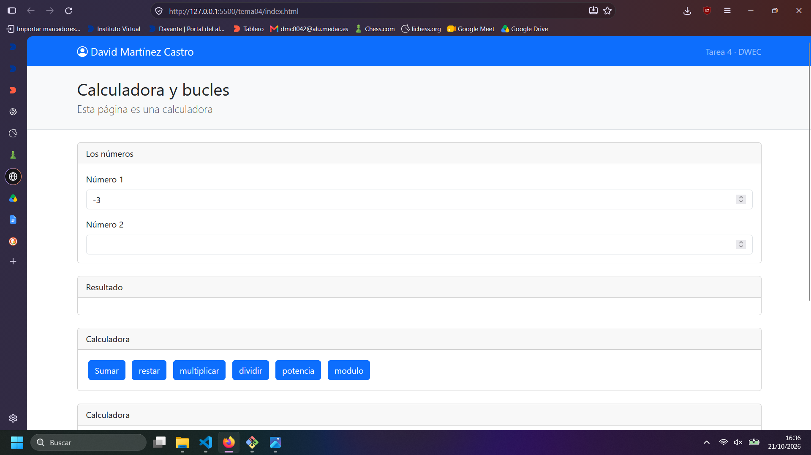
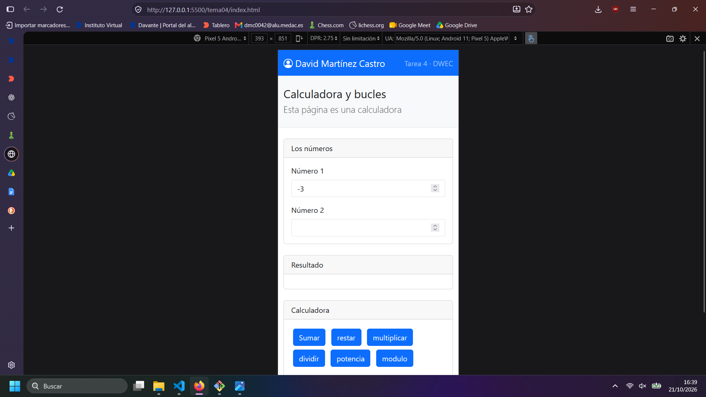
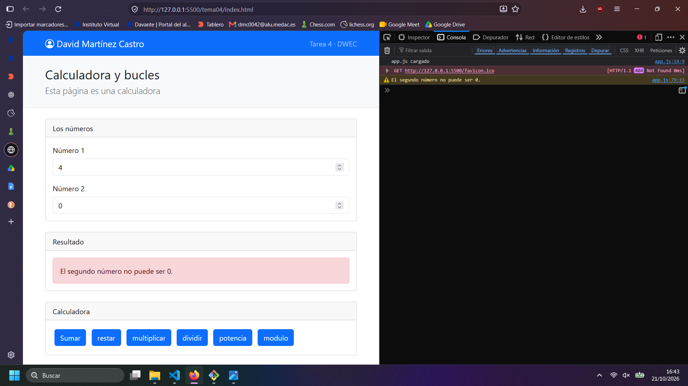
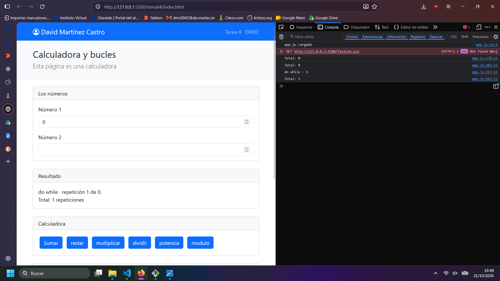
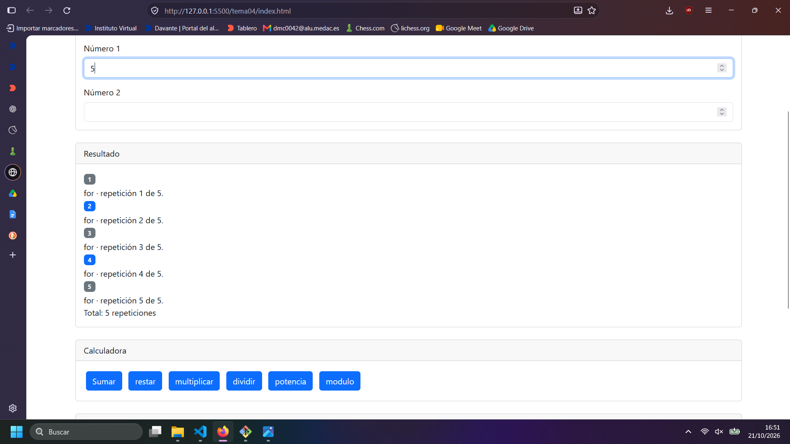

# Tarea 4 · Calculadora y bucles

**Autor:** David Martínez Castro · Desarrollo Web en Entorno Cliente (DWEC) · 2.º DAW · Curso 2026-27

En esta carpeta está la práctica del tema 4, para verla se puede usar Live Server de visual estudio code, se escriben uno o dos números según el botón y se pulsa.

## Capturas

### a) La página entera

Se ve la página con mi nombre en el navbar.

### b) La página en el móvil

Principalmente cambia el tamaño de los márgenes que se reducen y que los botones quedan apilados.

### c) El error de dividir entre 0

Se ven dos números siendo el divisor 0, y un error tanto en la página como en consola sobre dividir entre 0.

### d) Los tres bucles con el número 0

El for y while no lo hacen ninguna vez, mientras que el do while lo hace una, porque primero ejecuta el código de dentro y luego revisa la condición a diferencia de for y while que lo hacen antes.

### e) Un bucle con badges

He puesto el 5, cambio los colores mediante los valores primary y secondary en anadirBadges() según sea el número par o impar.

## Reflexión

Todos sirven para hacer bucles, for se suele usar par bucles en los que se tiene que repetir un número determinado de veces, while cuando se tiene que repetir mientras se cumpla una condición y do while cuando quieres un bucle en el que al menos una vez se ejecute el código.
En el caso de do while con 0 se ejecuta una vez mientras que en el while no.

## Fuentes

- [ChatGPT](https://chatgpt.com)

## Uso de IA

ChatGPT: para informarme sobre las diferencias entre for, while y do while.
Claude: añadir comentarios a las funciones de js y detectar errores.