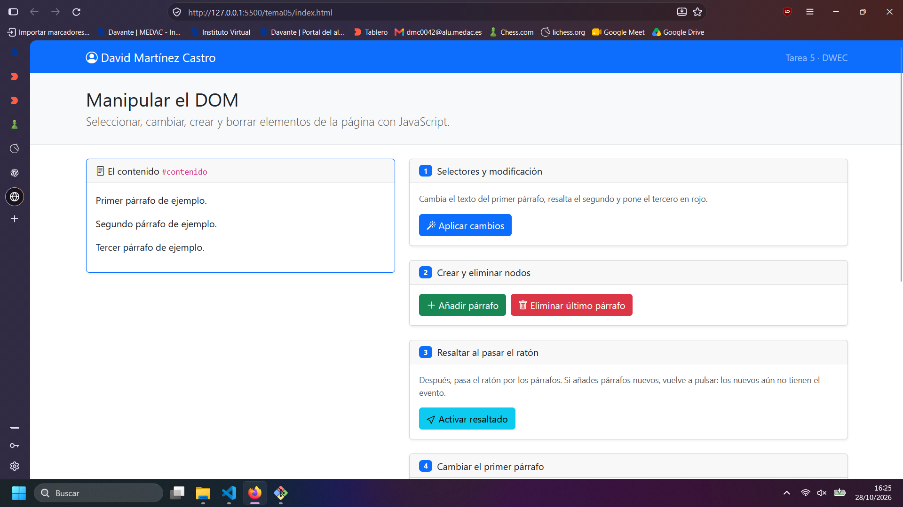
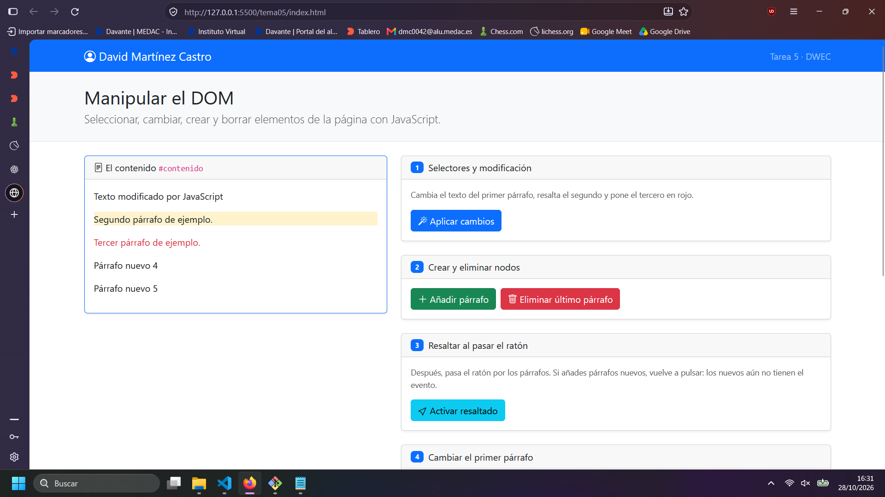
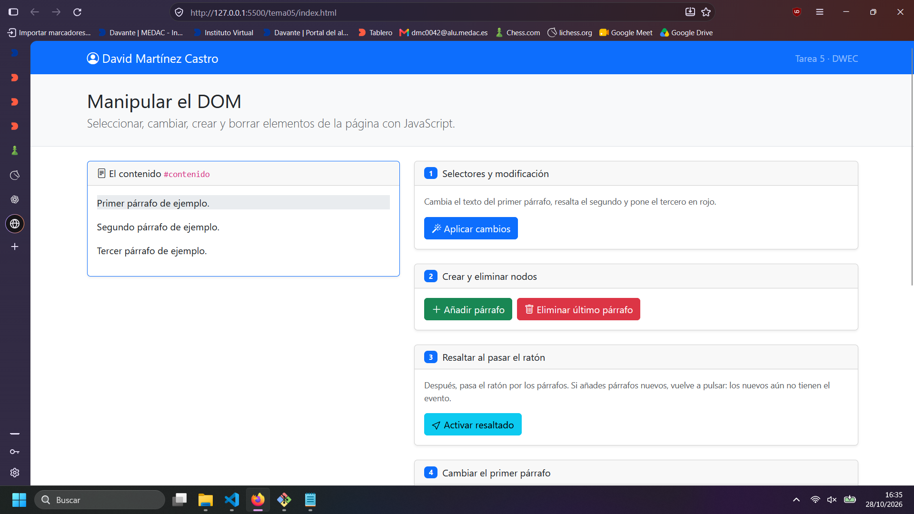
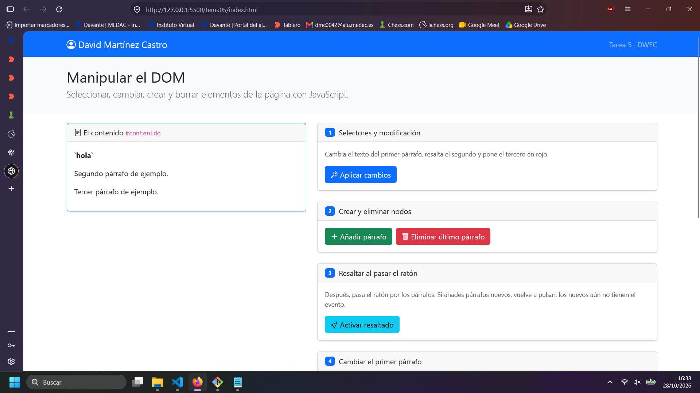
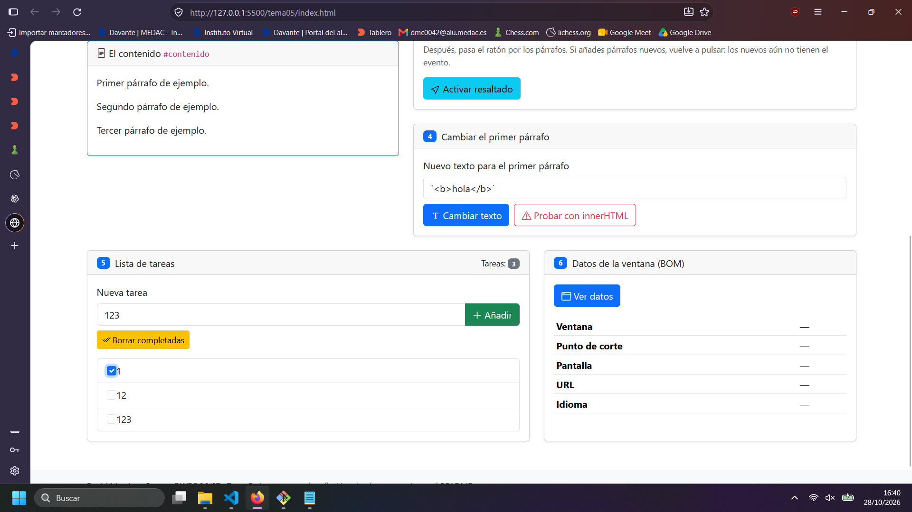

# Tarea 5 · Manipular el DOM

**Autor:** David Martínez Castro · Desarrollo Web en Entorno Cliente (DWEC) · 2.º DAW · Curso 2026-27

En esta carpeta está la práctica del tema 5 de desarrollo en entorno cliente y y se puede ver abriendo el html con live server y la consola con f12.

## Capturas

### a) La página recién cargada

Se ve mi nombre y los párrafos de partida, también los bostones de los tres primeros ejercicios.

### b) Ejercicios 1 y 2

Al pulsar aplicar cambios, ha cambiado el texto del primer párrafo,el color de fondo del segundo y el color de la letra del tercero.
He usado getelementById, querySelector y querySelectorAll.
Al pulsar añadir parrafo se añade un párrafo y he usado querySelector;

### c) Ejercicio 3: resaltado al pasar el ratón

Está resaltado el primer párrafo y si añades nuevos parrafos el  resaltado no se aplicará a los nuevos hasta que pulses de nuevo activar resaltado.

### d) Ejercicio 4: `<b>hola</b>` con innerHTML

Cuando usabas Cambiar texto las etiquetas de html se incluían en el contenido del parrafo, mientras que con innerHTML se aplican las etiquetas y el contenido aparece en negrita.

### e) Ejercicio 5: la lista de tareas

Se ven las tres tareas pedidas y una de ellas marcada.

### f) Ejercicio 6: los datos de la ventana en el móvil

En el movil sale como xs y en el ordenador como xxl.

## Reflexión

Que text content trata las etiquetas de HTML como texto, sin interpretarlas, mientras que inner HTML si que las interpreta.
Esto hace que usar innerHTML sea más peligroso que textContent debido a que permite la inyección de código.
En el caso de `<b>hola</b>` se ha podido observar como usando innerHTML el se aplicaba la etiqueta b y se mostraba el hola en negrita.

## Fuentes

- ChatGPT(https://ChatGPT.com)

## Uso de IA

ChatGPT:

Prompts:
    qué diferencia hay entre textContent e innerHTML,
    en js como se usa esto? document.getElementsByClassName(),
    como se añaden clases a un elemento de js?,
    diferencia entre queryselector queryselector all y getelement by id,
    como se quita una clase de un elemento?,
    como compruebo que una variable no esta vacia?,
    como funciona el for of ?

He usado estas preguntas para resolver dudas y entender mejor javascript.

Claude: añadir comentarios al js.