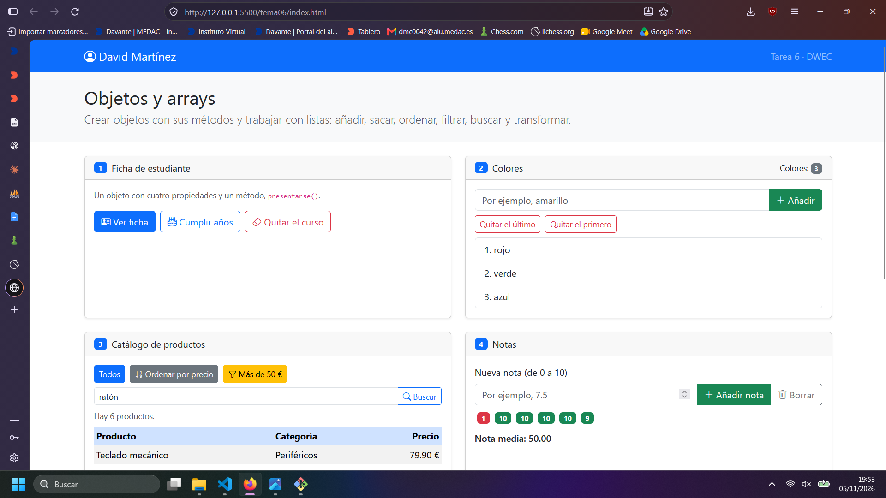
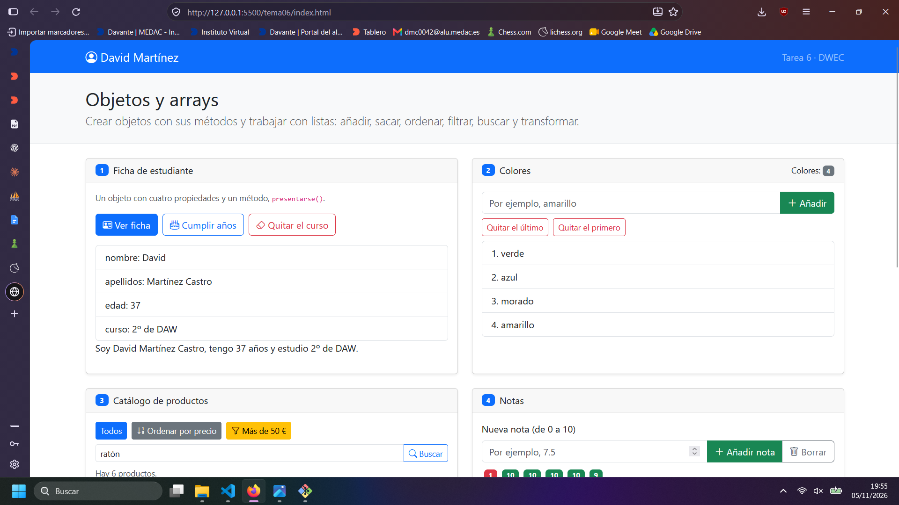
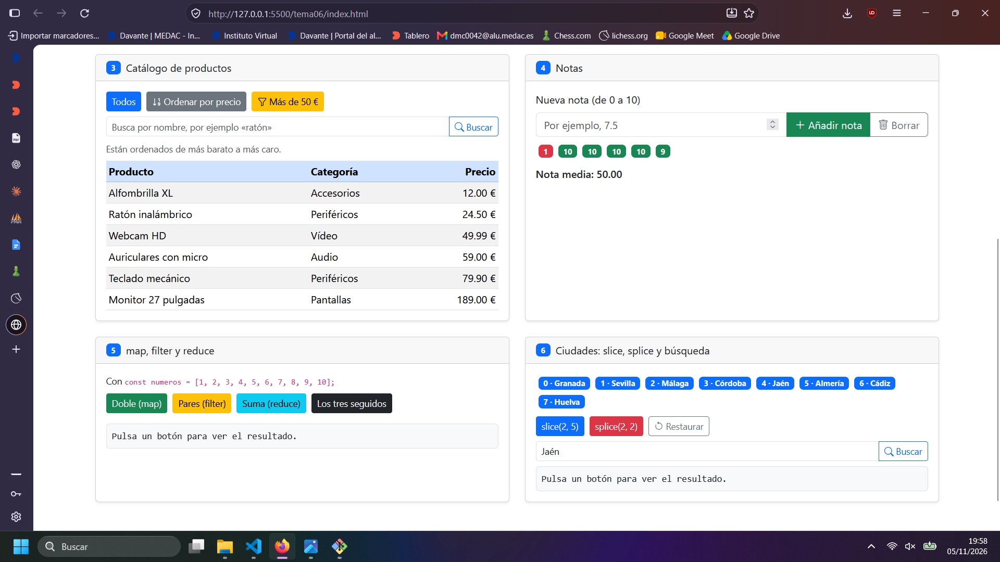
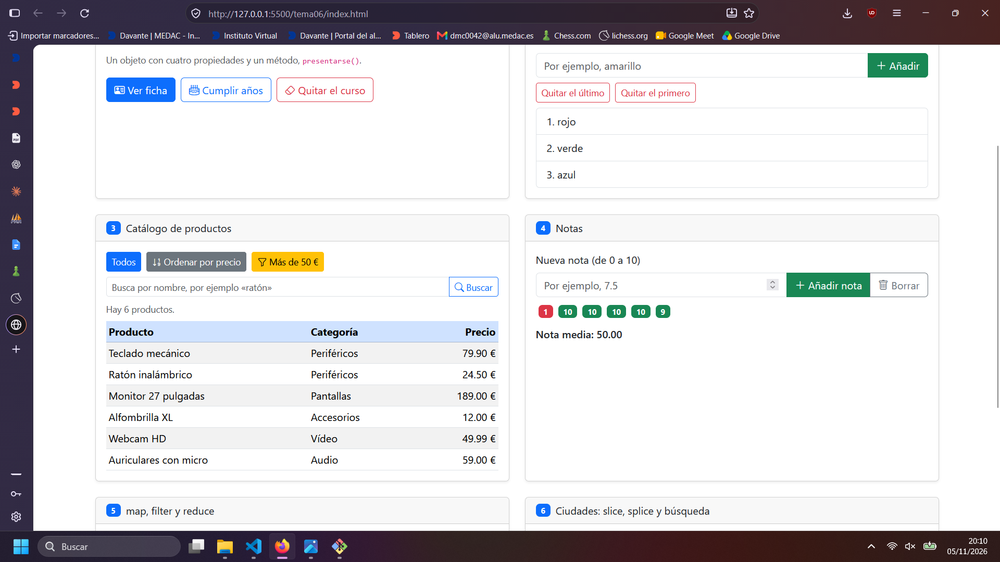
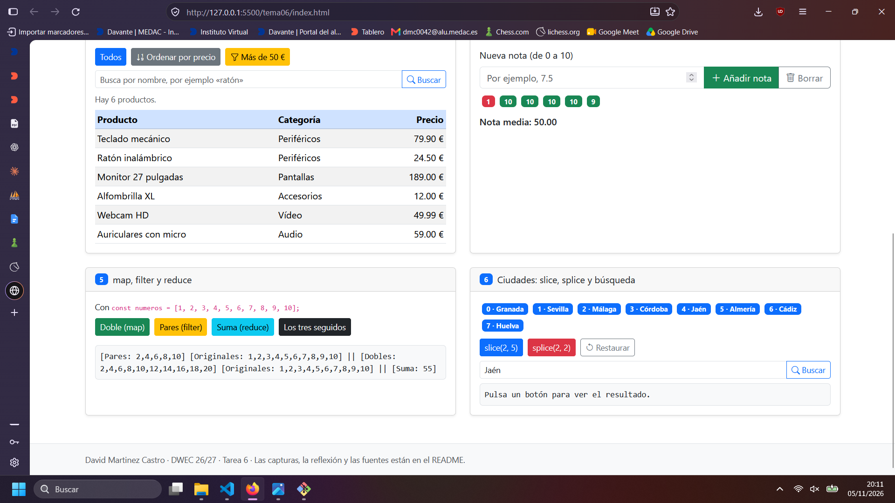
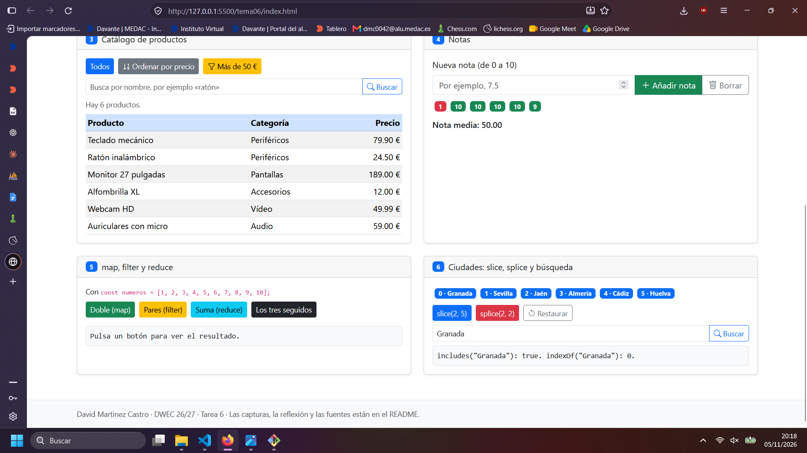

# Tarea 6 · Objetos y arrays

**Autor:** David Martínez Castro · Desarrollo Web en Entorno Cliente (DWEC) · 2.º DAW · Curso 2026-27
ç

Es el ejercicio del tema 6, se puede ver usando live server de vs code.

## Capturas

### a) La página recién cargada

Se ve mi nombre, y los ejercicios pedidos.

### b) Ejercicios 1 y 2: la ficha y los colores

En la ficha he usado los métodos verFicha cumplirAnios y quitarCurso, en la lista de colores mostrarColores, avisar2, anadirColores, quitarPrimero, quitarUltimo.

### c) Ejercicio 3: el catálogo ordenado por precio

Para la comparación use sort y ordeno una copia para poder mantener el array original.

### d) Ejercicio 4: las notas y la media

### e) Ejercicio 5: los tres métodos seguidos

Los pares son un array con los pares, los dobles un array con cada número múltiplicado por dos, y suma suma todos los del array.

Para cada método se usa map, filter y reduce respectivamente.

### f) Ejercicio 6: después de splice y de buscar una ciudad

Quita Málaga y Córdoba.
En este caso al buscar Granada su indice sigue siendo el mismo porque no se ve afectado por el splice.

## Reflexión

Para cambiar el array original se usan splice(), push(), pop() y shift(). slice en cambio te devuelve un array nuevo, en este caso se con slice(2,5) devuelve un array nuevo con el corte sin modificar el array original. En el ejercicio 3 se usa una copia porque al usar sort se modifica el array original. 
## Fuentes
- ChatGPT (https://chatgpt.com)
- Claude   (https://claude.ai)
## Uso de IA

He usado chatGPT y claude para recordar el funcionamiento de algunas funciones como for, foreach, sort, splice, slice, map entre muchas otras que desconocía y para preguntar que fallaba en mi código cuando no he podido determinar el error. 
