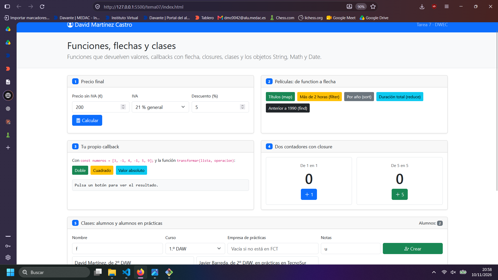
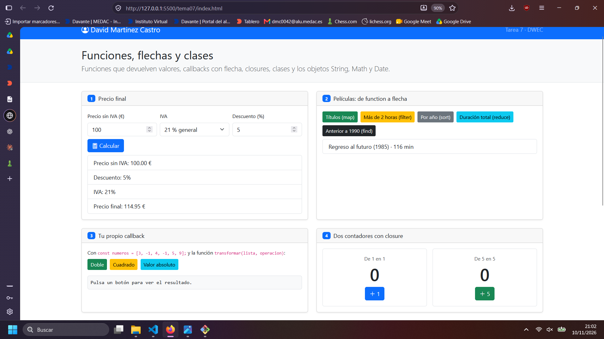
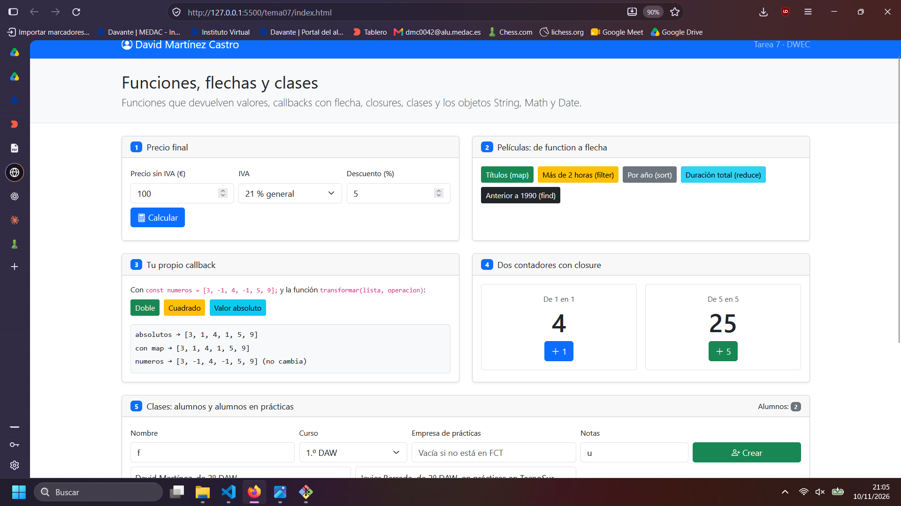
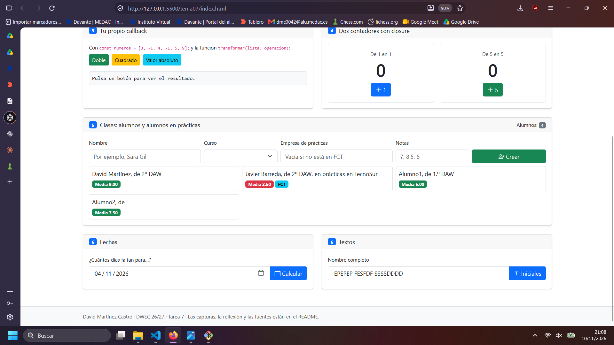
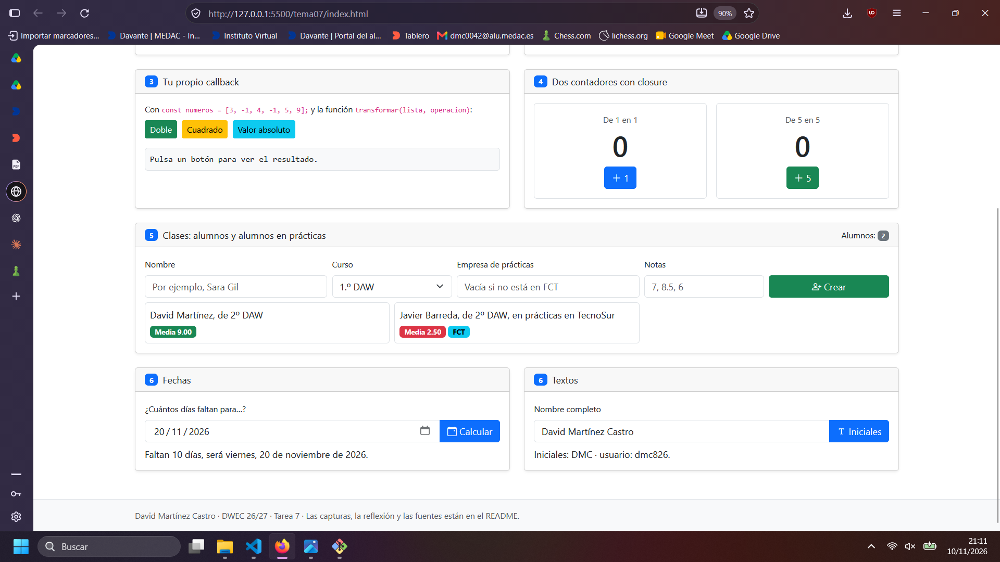

# Tarea 7 · Funciones, flechas y clases

**Autor:** David Martínez Castro · Desarrollo Web en Entorno Cliente (DWEC) · 2.º DAW · Curso 2026-27

> **Plantilla de la tarea 7.** Cómo usarla:
>
> 1. Copia esta carpeta en tu repositorio de DWEC y cámbiale el nombre a `tema07`.
> 2. `index.html` ya está maquetado: una card por ejercicio (el 6 tiene dos). No cambies los `id` ni el `onclick` de los botones.
> 3. `js/app.js` trae una función por botón con `TODO`. Ya están hechas `pintarLista()`, `formatearEuros()`, `pintarAlumnos()` y un modelo en los ejercicios 3, 4 y 6.
> 4. Flechas en todos los callbacks y nunca una flecha como método. Las funciones de los botones, con `function`.
> 5. Sustituye las imágenes de `capturas/` por las tuyas, **con el mismo nombre**.
> 6. Todo lo que va entre [corchetes] es un hueco: cámbialo por lo tuyo. Al terminar, borra este aviso.

En esta carpeta está el contenido de los ejercicios del tema 7, se pueden visualizar mediante live server en visual studio code.

## Capturas

### a) La página recién cargada

Se ve mi ejercicio y los nombres de los alumnos creados dentro de app.js.

### b) Ejercicios 1 y 2: el precio y las películas

calcularPrecio() aplica primero el descuento luego el iva y devielve el resultado, tiene por defecto iva=21 y descuento=0.

### c) Ejercicios 3 y 4: tu callback y los contadores

transformar recorre la lista y hace una operacion con cada elemento, devuelve un arrray nuevo con los resultados haciendo push y lo devuelve. 

Cada contador lleva su propia cuenta por que se crea una una funcion independiente con su propia cuenta.

### d) Ejercicio 5: los alumnos

Si empresa esta vacía se crea un objeto Alumno, si en cambio tiene contenido se crea un objeto AlumnoFCT.

### e) Ejercicio 6: fechas y textos

He probado la fecha 20/11/2026, salen 10 días, se redondea porque las fechas en milisegundos no dan siempre dias exactos debido a los cambios horarios, de esta forma se evita el problema.

## Reflexión

Cambia la forma de escribir la función, con la flecha es más corto y cómodo, además de , el comportamiento es el mismo a excepción de this que se hereda automáticamente en las funciones con flecha según el contexto. El return hace falta cuando usas function, ya que con la flecha el return se hace automaticamente. 

Los métodos no se escriben con flecha porque normalmente quieres que el comportamiento del this funcione apuntando al objeto en el cual está el método, usando la flecha y this, no apuntaría al propio objeto.

## Fuentes

- [ChatGPT](https://chatgpt.com)
- [Claude](https://claude.ai)

## Uso de IA

He usado tanto chatgpt como claude para ayudarme a entender funciones y corregir, algunos de los prompts que he usado son los siguientes:
-corrige en funcion de lo que se pide en los comentarios 
-con esto se convierte en un array? textoNotas.split(",").map((texto) => Number(texto.trim()));
-como devuelvo una funcion?
-el find en js como se usa?
-que hace map?
-como puedo saber si un array esta vacio?
-y reduce que hace?
-notas split cambia el array original?